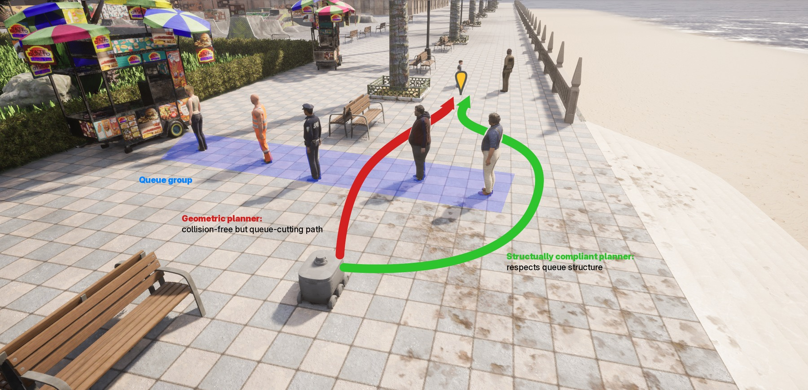
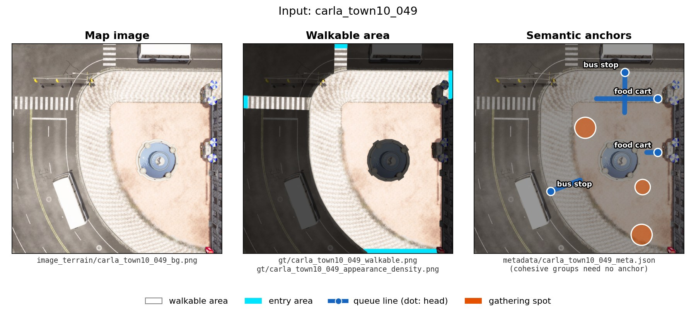
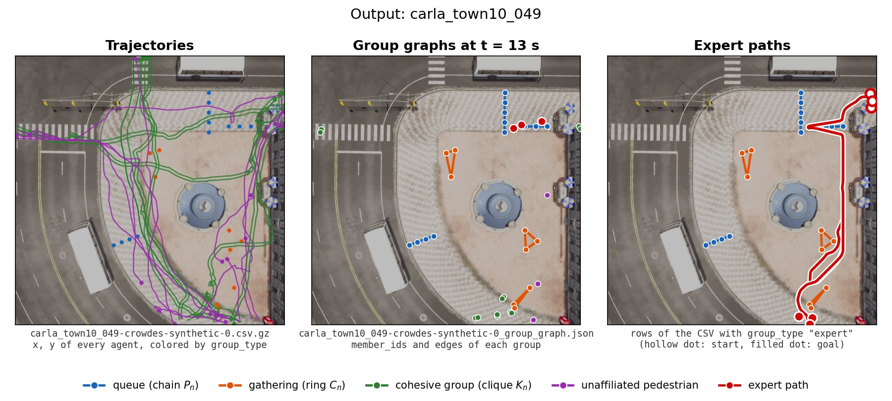
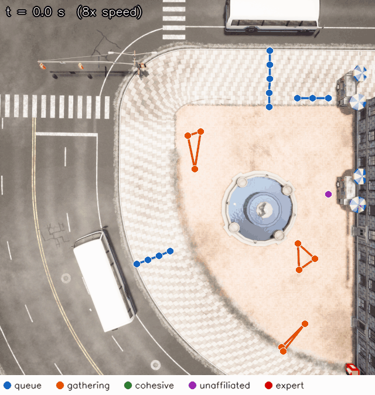

<div align="center">

# TopoUrbanBench: Group-Structural Compliance Evaluation for Urban Robot Navigation

<a href="https://openreview.net/forum?id=1JcOSLXzHB"></a>
<a href="#"></a>
<a href="LICENSE"></a>

<em>CoRL 2026 · Austin, Texas, USA</em>

<p>
Haun Jo<sup>1,2 *</sup>,
Hakbin Kim<sup>2</sup>,
Mooyeol Baek<sup>2</sup>,
Hwiyeon Yoo<sup>2</sup>,
Jaeuk Shin<sup>2</sup>,
<br>
Chanmi You<sup>2</sup>,
Seunghyun Lee<sup>2</sup>,
Seong-heum Kim<sup>1</sup>,
Sunwook Choi<sup>2 †</sup>
</p>
<p>
<sup>1</sup> Soongsil University &nbsp;&nbsp; <sup>2</sup> NAVER LABS
<br>
<sub><sup>*</sup> Work done during an internship at NAVER LABS. &nbsp;&nbsp; <sup>†</sup> Corresponding author.</sub>
</p>



</div>

This repository contains the code of **TopoUrbanBench**. It generates pedestrian scenes with queues, gatherings, and
cohesive walking groups on maps extracted from [CARLA](https://carla.org/), with crowds from
[CrowdES](https://github.com/InhwanBae/Crowd-Behavior-Generation), and it scores a trajectory against these groups with
three metrics (QCR, GDS, and CPI). See the [paper](https://openreview.net/forum?id=1JcOSLXzHB) for the benchmark and the
method.


## 📰 News

- **[2026/11]** Released the scene generation pipeline and the compliance metrics.
- **[2026/09]** TopoUrbanBench was accepted to CoRL 2026.


## 📋 TODO

- [x] Scene generation pipeline
- [x] Compliance metrics (QCR, GDS, and CPI)
- [x] Demo map (Town10)
- [ ] Full map set
- [ ] Imitation-learning datasets
- [ ] Closed-loop evaluation benchmark
- [ ] Baselines and fine-tuned checkpoints


## 🛠️ Installation

### Prerequisites
- **OS:** Linux (tested on Ubuntu). **GPU:** optional. The code uses a CUDA GPU when one is available and runs on the CPU otherwise.
- [Conda](https://docs.anaconda.com/miniconda/), Python 3.10, PyTorch 2.2.2 (pinned in `requirements.txt`, as in CrowdES).
- **CARLA 0.9.16** is optional and only needed to [extract new maps](#2-extract-new-maps-from-carla-optional).

### Steps
```sh
git clone https://github.com/haunjo/topourbanbench.git
cd topourbanbench

# Run the scripts and demo.py inside this environment
conda create -n topourban python=3.10 -y
conda activate topourban
pip install -r requirements.txt
```

On Blackwell GPUs (e.g., RTX 50 series, RTX PRO 6000), PyTorch 2.2.2 has no CUDA kernels. Install the CUDA 12.8 build of
PyTorch 2.7.1 instead. The rest of the requirements stay the same:

```sh
pip install torch==2.7.1 --index-url https://download.pytorch.org/whl/cu128
grep -v '^torch==' requirements.txt | pip install -r /dev/stdin
```


## 📦 Pretrained Weights

Scene generation uses the official CrowdES model trained on ZARA2, which is the default of every generation script and
the model used in the paper. Download it from the
[CrowdES Model Zoo](https://github.com/InhwanBae/Crowd-Behavior-Generation/releases/tag/v1.0-model) and unzip it inside
`topourbanbench/generation/crowdes/`:

```sh
cd topourbanbench/generation/crowdes
wget https://github.com/InhwanBae/Crowd-Behavior-Generation/releases/download/v1.0-model/CrowdES_zara2_pretrained.zip
unzip CrowdES_zara2_pretrained.zip && rm CrowdES_zara2_pretrained.zip
cd -
```

The archive already contains the expected layout:

```
topourbanbench/generation/crowdes/checkpoints/zara2/
├── emitter_pre/   # config.json, pytorch_model.bin
├── emitter/       # config.json, diffusion_pytorch_model.bin
└── simulator/     # config.json, pytorch_model.bin
```

> The demo and scene generation support the ZARA2 model only. The other models in the CrowdES Model Zoo are not
> supported in this release.


## 🚀 Usage

This release covers scene generation and the compliance metrics. Training and closed-loop evaluation will come in later
releases (see [TODO](#-todo)).

### Quick demo

`demo.py` generates one scene from the Town10 demo map and shows what goes in and what comes out:

```sh
python demo.py              # generate carla_town10_049 (about a minute on a GPU), then draw its input and output
python demo.py --example    # draw the example output in examples/ instead (no CrowdES weights needed)
```

It lists every file it reads and writes, and saves `input.png`, `output.png`, and `replay.gif` to
`output/demo/carla_town10_049/`.

**Input.** An extracted map in `topourbanbench/generation/crowdes/datasets/Synthetic/`:

<div align="center">

</div>

| File | Content |
| :--- | :--- |
| `image_terrain/<scene>_bg.png` | bird's-eye map image, 2048 × 2048 px for 41 m × 41 m |
| `gt/<scene>_walkable.png` | where pedestrians can walk |
| `gt/<scene>_appearance_density.png` | where pedestrians enter the map |
| `metadata/<scene>_meta.json` | semantic anchors (queue heads at bus stops and food carts, gathering spots) and the map position in CARLA |

The archetype parameters come from [`scenarios.yaml`](topourbanbench/generation/crowdes/configs/scenarios.yaml).

**Output.** Three files per scene in `output/generated/synthetic/topo_ft/`:

<div align="center">

</div>

| File | Content |
| :--- | :--- |
| `<scene>-crowdes-synthetic-0.csv` | one row per agent and frame (2 min at 20 Hz): `scene`, `agent_id`, `agent_type`, `frame`, `x`, `y`, `group_id`, `group_type` |
| `<scene>-crowdes-synthetic-0_group_graph.json` | one entry per group: `group_id`, `group_type`, `topology`, `member_ids`, `edges` |
| `<scene>-crowdes-synthetic-0_last_frame.png` | preview of the last frame with the expert paths |

`x` and `y` are pixels of the map image. `group_type` is `queue`, `gathering`, `cohesive`, `none` (unaffiliated), or
`expert` (compliant reference paths). `group_id` points into the group graph, and is -1 for unaffiliated agents and -2
for expert paths. The topology is `directed_chain` for queues, `ring` for gatherings, and `clique` for cohesive groups,
and `edges` are index pairs into `member_ids`.

<div align="center">

<br>
<sub><code>replay.gif</code>: the generated scene at 8x speed, with the group graphs and the expert paths.</sub>
</div>

### 1. Generate scenes from the demo map

The demo map `carla_town10_049` is in `topourbanbench/generation/crowdes/datasets/Synthetic/`. It has 4 queue anchors
(2 bus stops and 2 food carts) and 3 gathering anchors.

```sh
# with per-scene randomized group parameters (the Topo-FT setting)
./scripts/generate_crowdes_trajectories.sh --scene carla_town10_049 --randomize
```

The output files are described in [Quick demo](#quick-demo), and an example output is in [`examples/`](examples).

| Option | Effect |
| :--- | :--- |
| `--scene <name>` | Generate one scene. |
| `--town <town03\|town05\|town10\|all>` | Generate every scene of a town. The default is `town10`. |
| `--randomize` | Sample group parameters per scene from the ranges in `configs/scenarios.yaml`. |
| `--out_subset <name>` | Name of the output folder. By default `topo_ft` if any archetype is enabled, else `standard_ft`. |
| `--config <yaml>` | CrowdES model config, relative to `topourbanbench/generation/crowdes/`. The default is ZARA2. |
| `--dataset_root <dir>` | Folder with extracted maps. The default is `./datasets/Synthetic`. |
| `--force` | Regenerate scenes whose CSV already exists. |

**Unstructured crowds (Standard-FT).** `--out_subset` only renames the output folder. To generate crowds without
formations, set `enabled: false` for `queue`, `cohesive`, and `gathering` under `scenarios:` in
`configs/scenarios.yaml`. The scenes are then written to `standard_ft/`, and the expert paths avoid dense crowd regions
instead of formations.

**Scene variants.** `generate_diversity_groups.py` generates the demo map again with another seed or group preset:

```sh
cd topourbanbench/generation/crowdes
python generate_diversity_groups.py --mode standard          # another seed and a slightly different layout
python generate_diversity_groups.py --mode long_queue        # longer queues, no gatherings
python generate_diversity_groups.py --mode large_gathering   # larger gatherings, no queues
```

Each mode writes its files to `output/generated/synthetic/topo_ft/` as `<scene>-crowdes-synthetic-N.*` with its own N
(1, 2, and 3), so the variants never overwrite each other or the main run (N = 0).

### 2. Extract new maps from CARLA (optional)

This step needs [CARLA 0.9.16](https://github.com/carla-simulator/carla/releases/tag/0.9.16). Extract the Linux package
into `../CARLA_0.9.16`, next to the repository, or set `CARLA_ROOT` to the folder that contains `CarlaUE4.sh`. Then
install the matching Python API:

```sh
pip install carla==0.9.16
```

```sh
./scripts/generate_carla_scenarios.sh --town Town10HD_Opt --num_images 10
```

`--town` is `Town03`, `Town05`, or `Town10HD_Opt` (the default), and `--num_images` sets the number of scenes (30 by
default). Each scene gets a map image (`image_terrain/`), walkable and density maps (`gt/`), a pixel scale
(`homography/`), and semantic anchors (`metadata/`). The navmesh is baked on first use and cached in `navmesh/`.

> The script stops any running `CarlaUE4` process, starts its own server on port 2000, stops it again at the end, and
> writes scenes named `carla_<town>_<index>` into `datasets/Synthetic/`. Extracting into the default folder overwrites
> the demo map if a scene gets the same name. Pass `--dataset_root` to write elsewhere, and give the same folder to
> `generate_crowdes_trajectories.sh --dataset_root`.

### 3. Score a trajectory with the metric engine

`TopologicalMetricEngine` depends only on NumPy and SciPy and scores any trajectory against a scene's group graph.
Generated positions are map-image pixels, so convert them to CARLA world coordinates in meters with the scene metadata
first. The example below scores the injected expert path of a generated scene:

```python
import json
import pandas as pd
from topourbanbench.metrics import TopologicalMetricEngine

scene = "carla_town10_049"
run = f"output/generated/synthetic/topo_ft/{scene}-crowdes-synthetic-0"
graph = json.load(open(f"{run}_group_graph.json"))
meta = json.load(open(f"topourbanbench/generation/crowdes/datasets/Synthetic/metadata/{scene}_meta.json"))
df = pd.read_csv(f"{run}.csv")

# map-image pixels (2048 x 2048) -> CARLA world coordinates in meters
s = meta["ortho_size"] / 2048.0
df["wx"] = -df["y"] * s + meta["center_x"] + meta["ortho_size"] / 2
df["wy"] = df["x"] * s + meta["center_y"] - meta["ortho_size"] / 2

expert_id = df.loc[df["group_type"] == "expert", "agent_id"].iloc[0]
engine = TopologicalMetricEngine(robot_radius=0.3)
engine.reset(graph)
for frame, rows in df.groupby("frame"):                      # 20 Hz
    ego = rows[rows["agent_id"] == expert_id]
    if ego.empty:
        continue
    peds = rows[rows["group_type"] != "expert"]              # the other expert paths are not pedestrians
    engine.evaluate_frame(
        ego_loc=[ego["wx"].iloc[0], ego["wy"].iloc[0]],
        active_agents={int(a): [x, y] for a, x, y in zip(peds["agent_id"], peds["wx"], peds["wy"])},
        group_graph=graph,
        dt=0.05,
    )

print(engine.get_episode_metrics())   # {'QCR': ..., 'GDS': ..., 'CPI': ..., ...}
```

QCR is the number of queues the trajectory crosses. GDS and CPI are the seconds spent in the empty center of a gathering
and within 1.2 m of a walking group. Lower is better for all three.

`python -m topourbanbench.metrics.test_topological_metrics` runs the unit tests.


## 📁 Repository Layout

```
topourbanbench/
├── demo.py                               # one-scene demo that draws the input and output of the generator
├── scripts/
│   ├── generate_crowdes_trajectories.sh  # scene generation: crowds, group graphs, and expert paths
│   └── generate_carla_scenarios.sh       # map extraction from CARLA (optional)
├── topourbanbench/
│   ├── generation/crowdes/               # scene generation, with CrowdES vendored (no separate install)
│   │   ├── trainval.py                   # entry point that the generation script calls (--synthetic)
│   │   ├── configs/scenarios.yaml        # archetype parameters (group sizes, spacing, ranges, on/off)
│   │   ├── CrowdES/                      # CrowdES emitter and simulator, group graph builder in group_graph/
│   │   ├── utils/                        # expert paths (expert_trajectory.py) and anchor placement
│   │   ├── extract_carla_maps.py         # CARLA map extraction with bus stop and food cart anchors
│   │   ├── generate_diversity_groups.py  # scene variants
│   │   ├── generate_foodcart_queues.py   # food-cart queues for maps without queue anchors
│   │   └── datasets/Synthetic/           # extracted maps (the Town10 demo map)
│   ├── metrics/                          # TopologicalMetricEngine (QCR, GDS, and CPI) and its unit tests
│   └── utils/topology_utils.py           # edges of the group graphs (chain, ring, and clique)
├── examples/                             # example outputs of the demo map
└── assets/                               # README figures
```

Generated scenes and the demo pictures are written to `output/` (gitignored).


## 🙏 Acknowledgments

TopoUrbanBench is built on top of [**CrowdES**](https://github.com/InhwanBae/Crowd-Behavior-Generation) (crowd emitter
and simulator, and the pretrained models used here) and [CARLA](https://carla.org/). We thank the authors of these
projects for releasing their code and models. This work was done during the first author's internship at NAVER LABS.


## ⚖️ License

This code is released under the [MIT License](LICENSE), Copyright (c) 2026 NAVER LABS. TopoUrbanBench vendors
[CrowdES](https://github.com/InhwanBae/Crowd-Behavior-Generation) (MIT License, Copyright (c) 2024 Inhwan Bae), which
includes code from [YNet](https://github.com/HarshayuGirase/Human-Path-Prediction) (MIT License). The CrowdES pretrained
weights are downloaded from the official CrowdES release. The demo map, the example previews, and the figures in this
README are derived from [CARLA](https://github.com/carla-simulator/carla) towns, whose assets are distributed under the
CC-BY License. See [NOTICE](NOTICE) for the full notices.


## 📚 Citation

TopoUrbanBench has been accepted to CoRL 2026. If you find our work useful, please cite:

```bibtex
@inproceedings{jo2026topourbanbench,
  title     = {TopoUrbanBench: Group-Structural Compliance Evaluation for Urban Robot Navigation},
  author    = {Jo, Haun and Kim, Hakbin and Baek, Mooyeol and Yoo, Hwiyeon and Shin, Jaeuk and
               You, Chanmi and Lee, Seunghyun and Kim, Seong-heum and Choi, Sunwook},
  booktitle = {Conference on Robot Learning (CoRL)},
  year      = {2026}
}
```

If you use the generation pipeline, please also cite CrowdES:

```bibtex
@inproceedings{bae2025continuous,
  title     = {Continuous Locomotive Crowd Behavior Generation},
  author    = {Bae, Inhwan and Lee, Junoh and Jeon, Hae-Gon},
  booktitle = {Proceedings of the IEEE/CVF Conference on Computer Vision and Pattern Recognition (CVPR)},
  year      = {2025}
}
```
